# Target Brazil: E-commerce Operations SQL Case Study


An end-to-end SQL analysis of **99,441 orders** placed with Target in Brazil between September 2016 and
October 2018, built for the Scaler *Target SQL* business case. It answers every question in the brief with a
BigQuery query, goes further with six deep-dives (reviews vs. lateness, local vs. cross-state fulfilment,
seller coverage, categories, retention, peak-season lateness), and ends with eight ranked, evidence-backed
recommendations.

**[Read the report (PDF)](report/Target_SQL_Case_Study_Guntuku_Hariprasad.pdf)** · [Word version](report/Target_SQL_Case_Study_Guntuku_Hariprasad.docx) ·
[Notebook](notebooks/Target_Brazil_SQL_Case_Study.ipynb) ·
[Notebook as HTML](notebooks/Target_Brazil_SQL_Case_Study.html) · [All queries](sql/bigquery/00_all_queries.sql) ·
[Problem statement](docs/problem_statement.md)

---

## Key findings

| | |
|---|---|
| **+137%** | Order value, Jan-Aug 2018 vs Jan-Aug 2017 (R$3.67M → R$8.69M). Orders grew 135%, average order value stayed flat at ~R$160: growth is entirely volume. |
| **Plateau** | Orders rose from 800 (Jan 2017) to a Black Friday peak of 7,544 (Nov 2017), then held at ~6.2-7.3k a month through 2018. |
| **66.5%** | Share of customers in just three states (SP, RJ, MG). 59.7% of sellers are in SP. |
| **3.5x** | Delivery gap between São Paulo (8.3 days) and Roraima (29.0 days). Freight is 2.8x higher in RR (R$42.98 vs R$15.15). |
| **4.32 → 1.70** | Average review score for orders delivered 15+ days early vs 8+ days late; 70% of very late orders get 1 star. |
| **2x faster** | Same-state orders arrive in 7.5 days vs 14.6 cross-state, with 43% lower freight. |
| **96.9%** | Customers who ordered only once. |

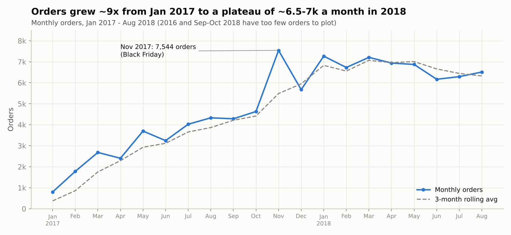

<table>
<tr>
<td>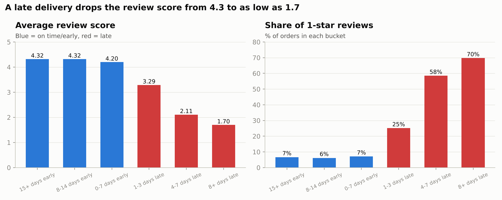</td>
<td>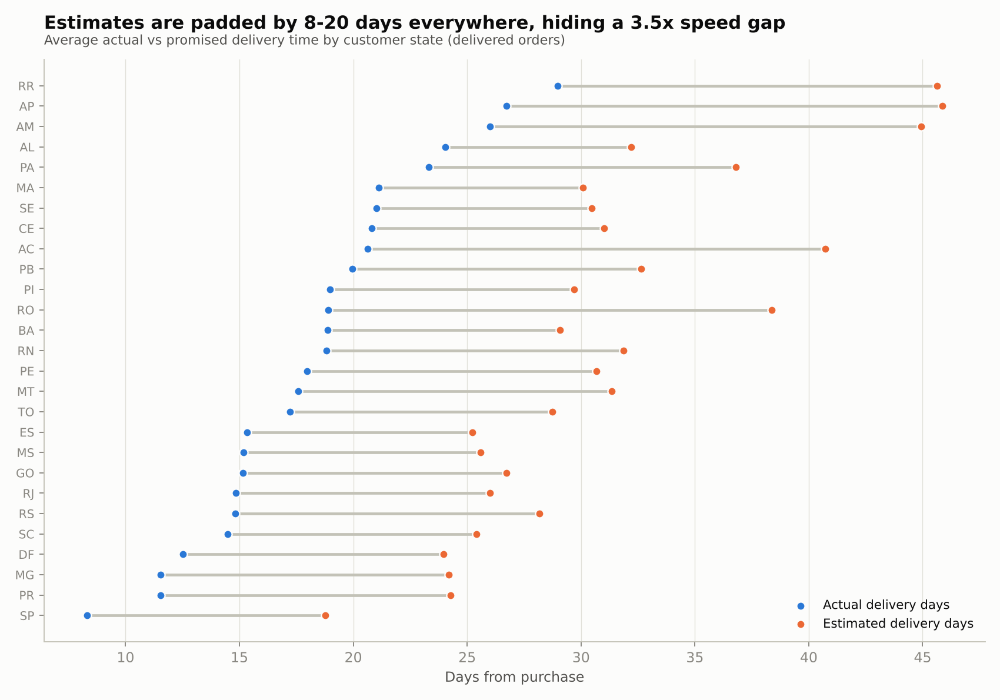</td>
</tr>
<tr>
<td>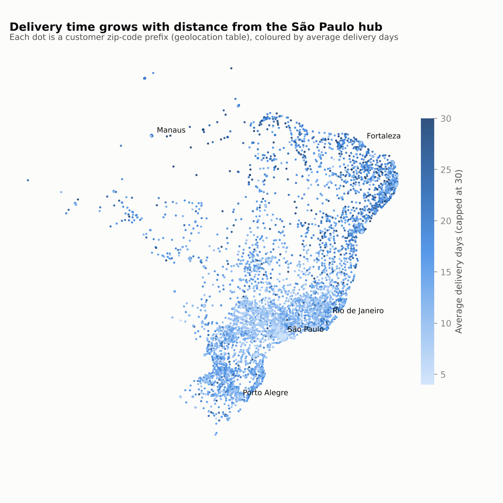</td>
<td>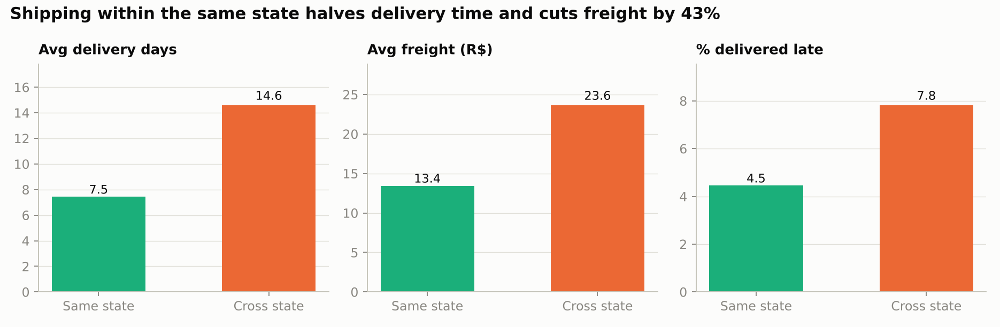<br>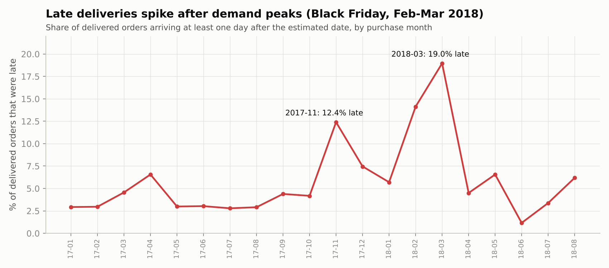</td>
</tr>
</table>

## Recommendations

1. **Fix reliability before speed.** A late order loses 0.9-2.6 review stars; an early one gains almost nothing. Track on-time % as the headline logistics KPI, predict late orders and notify/compensate proactively. Start with RJ (13.5% late, second-largest market).
2. **Recalibrate delivery estimates per state.** Estimates are padded by 11 days on average and by up to 20 days in the North. Showing realistic dates at checkout improves conversion; adding buffer in AL and MA (20-24% late) protects reviews.
3. **Localise supply: regional sellers and a North/North-East cross-dock.** Same-state items arrive 2x faster with 43% lower freight. 60% of sellers sit in SP while BA, PE and RJ have 70-180 customers per seller. Recruit sellers there and pilot a cross-dock in the North-East.
4. **Make freight affordable in remote states.** Freight is 22-29% of the item price in the North/North-East vs 14% in SP. Bulk carrier contracts, subsidised shipping and free-shipping thresholds would unlock everyday purchases in markets that grew slowest.
5. **Plan peak capacity ahead of Black Friday and Q1.** Black Friday 2017 brought 5x a normal day's orders; late deliveries jumped to 12.4% that month and to 14-19% after the Q1 2018 surge. Pre-book carrier capacity and staff from October and temporarily widen estimates during peaks.
6. **Grow basket size with installments and bundles.** Average order value has been flat at ~R$160 for two years. 10x interest-free plans already carry R$415 tickets; promote them on high-ticket categories and add bundles and free-shipping thresholds.
7. **Build retention.** 97% of customers buy once. A loyalty programme, post-delivery coupons and personalised recommendations target the cheapest growth available, especially now that acquisition-led growth has plateaued.
8. **Time marketing to the afternoon and evening.** 38% of orders arrive 13:00-18:00 and 28% at night. Concentrate flash sales, push and paid-media budget in 13:00-22:00, and run maintenance at dawn.

## Questions answered

Every query is written in **BigQuery Standard SQL** (dataset `target`) and auto-translated to **DuckDB** so
it runs locally. Full results are saved as CSV; the "Top 10" link is the result screenshot used in the report.

| # | Question | SQL | Output |
|---|---|---|---|
| 1.1 | Data type of all columns in the customers table | [BigQuery](sql/bigquery/1_1_customers_column_types.sql) · [DuckDB](sql/duckdb/1_1_customers_column_types.sql) | [CSV](outputs/results/1_1_customers_column_types.csv) · [Top 10](outputs/screenshots/1_1_customers_column_types.png) |
| 1.2 | Time range between which the orders were placed | [BigQuery](sql/bigquery/1_2_order_time_range.sql) · [DuckDB](sql/duckdb/1_2_order_time_range.sql) | [CSV](outputs/results/1_2_order_time_range.csv) · [Top 10](outputs/screenshots/1_2_order_time_range.png) |
| 1.3 | Count of cities & states of customers who ordered | [BigQuery](sql/bigquery/1_3_cities_states_of_customers.sql) · [DuckDB](sql/duckdb/1_3_cities_states_of_customers.sql) | [CSV](outputs/results/1_3_cities_states_of_customers.csv) · [Top 10](outputs/screenshots/1_3_cities_states_of_customers.png) |
| 1.4 | Data profile: row counts and key coverage for every table | [BigQuery](sql/bigquery/1_4_table_profile.sql) · [DuckDB](sql/duckdb/1_4_table_profile.sql) | [CSV](outputs/results/1_4_table_profile.csv) · [Top 10](outputs/screenshots/1_4_table_profile.png) |
| 1.5 | Order status mix and missing delivery timestamps | [BigQuery](sql/bigquery/1_5_order_status_and_nulls.sql) · [DuckDB](sql/duckdb/1_5_order_status_and_nulls.sql) | [CSV](outputs/results/1_5_order_status_and_nulls.csv) · [Top 10](outputs/screenshots/1_5_order_status_and_nulls.png) |
| 2.1 | Is there a growing trend in orders over the years? (yearly view) | [BigQuery](sql/bigquery/2_1_yearly_trend.sql) · [DuckDB](sql/duckdb/2_1_yearly_trend.sql) | [CSV](outputs/results/2_1_yearly_trend.csv) · [Top 10](outputs/screenshots/2_1_yearly_trend.png) |
| 2.2 | Is there a growing trend in orders? (month-by-month series) | [BigQuery](sql/bigquery/2_2_monthly_trend.sql) · [DuckDB](sql/duckdb/2_2_monthly_trend.sql) | [CSV](outputs/results/2_2_monthly_trend.csv) · [Top 10](outputs/screenshots/2_2_monthly_trend.png) |
| 2.3 | Monthly seasonality in the number of orders | [BigQuery](sql/bigquery/2_3_monthly_seasonality.sql) · [DuckDB](sql/duckdb/2_3_monthly_seasonality.sql) | [CSV](outputs/results/2_3_monthly_seasonality.csv) · [Top 10](outputs/screenshots/2_3_monthly_seasonality.png) |
| 2.4 | Time of day when Brazilian customers place orders | [BigQuery](sql/bigquery/2_4_time_of_day.sql) · [DuckDB](sql/duckdb/2_4_time_of_day.sql) | [CSV](outputs/results/2_4_time_of_day.csv) · [Top 10](outputs/screenshots/2_4_time_of_day.png) |
| 3.1 | Month-on-month number of orders placed in each state | [BigQuery](sql/bigquery/3_1_mom_orders_by_state.sql) · [DuckDB](sql/duckdb/3_1_mom_orders_by_state.sql) | [CSV](outputs/results/3_1_mom_orders_by_state.csv) · [Top 10](outputs/screenshots/3_1_mom_orders_by_state.png) |
| 3.2 | How customers are distributed across states | [BigQuery](sql/bigquery/3_2_customers_by_state.sql) · [DuckDB](sql/duckdb/3_2_customers_by_state.sql) | [CSV](outputs/results/3_2_customers_by_state.csv) · [Top 10](outputs/screenshots/3_2_customers_by_state.png) |
| 4.1 | % increase in cost of orders, 2017 vs 2018 (Jan-Aug) | [BigQuery](sql/bigquery/4_1_cost_increase_2017_2018.sql) · [DuckDB](sql/duckdb/4_1_cost_increase_2017_2018.sql) | [CSV](outputs/results/4_1_cost_increase_2017_2018.csv) · [Top 10](outputs/screenshots/4_1_cost_increase_2017_2018.png) |
| 4.2 | Cost of orders by month, 2017 vs 2018 (Jan-Aug) | [BigQuery](sql/bigquery/4_2_cost_by_month_2017_vs_2018.sql) · [DuckDB](sql/duckdb/4_2_cost_by_month_2017_vs_2018.sql) | [CSV](outputs/results/4_2_cost_by_month_2017_vs_2018.csv) · [Top 10](outputs/screenshots/4_2_cost_by_month_2017_vs_2018.png) |
| 4.3 | Total & average order price for each state | [BigQuery](sql/bigquery/4_3_order_price_by_state.sql) · [DuckDB](sql/duckdb/4_3_order_price_by_state.sql) | [CSV](outputs/results/4_3_order_price_by_state.csv) · [Top 10](outputs/screenshots/4_3_order_price_by_state.png) |
| 4.4 | Total & average freight value for each state | [BigQuery](sql/bigquery/4_4_order_freight_by_state.sql) · [DuckDB](sql/duckdb/4_4_order_freight_by_state.sql) | [CSV](outputs/results/4_4_order_freight_by_state.csv) · [Top 10](outputs/screenshots/4_4_order_freight_by_state.png) |
| 5.1 | Delivery time and estimated-vs-actual gap per order (single query) | [BigQuery](sql/bigquery/5_1_delivery_time_per_order.sql) · [DuckDB](sql/duckdb/5_1_delivery_time_per_order.sql) | [CSV](outputs/results/5_1_delivery_time_per_order.csv) · [Top 10](outputs/screenshots/5_1_delivery_time_per_order.png) |
| 5.2 | Delivery performance summary (supporting 5.1) | [BigQuery](sql/bigquery/5_2_delivery_summary.sql) · [DuckDB](sql/duckdb/5_2_delivery_summary.sql) | [CSV](outputs/results/5_2_delivery_summary.csv) · [Top 10](outputs/screenshots/5_2_delivery_summary.png) |
| 5.3 | Top 5 states with the highest & lowest average freight value | [BigQuery](sql/bigquery/5_3_top5_freight_states.sql) · [DuckDB](sql/duckdb/5_3_top5_freight_states.sql) | [CSV](outputs/results/5_3_top5_freight_states.csv) · [Top 10](outputs/screenshots/5_3_top5_freight_states.png) |
| 5.4 | Top 5 states with the highest & lowest average delivery time | [BigQuery](sql/bigquery/5_4_top5_delivery_time_states.sql) · [DuckDB](sql/duckdb/5_4_top5_delivery_time_states.sql) | [CSV](outputs/results/5_4_top5_delivery_time_states.csv) · [Top 10](outputs/screenshots/5_4_top5_delivery_time_states.png) |
| 5.5 | Top 5 states where delivery is fastest compared to the estimate | [BigQuery](sql/bigquery/5_5_top5_fast_vs_estimate.sql) · [DuckDB](sql/duckdb/5_5_top5_fast_vs_estimate.sql) | [CSV](outputs/results/5_5_top5_fast_vs_estimate.csv) · [Top 10](outputs/screenshots/5_5_top5_fast_vs_estimate.png) |
| 5.6 | State delivery scorecard (all 27 states) | [BigQuery](sql/bigquery/5_6_delivery_scorecard_by_state.sql) · [DuckDB](sql/duckdb/5_6_delivery_scorecard_by_state.sql) | [CSV](outputs/results/5_6_delivery_scorecard_by_state.csv) · [Top 10](outputs/screenshots/5_6_delivery_scorecard_by_state.png) |
| 6.1 | Month-on-month orders by payment type | [BigQuery](sql/bigquery/6_1_mom_orders_by_payment_type.sql) · [DuckDB](sql/duckdb/6_1_mom_orders_by_payment_type.sql) | [CSV](outputs/results/6_1_mom_orders_by_payment_type.csv) · [Top 10](outputs/screenshots/6_1_mom_orders_by_payment_type.png) |
| 6.2 | Payment type share, value and installments (supporting 6.1) | [BigQuery](sql/bigquery/6_2_payment_type_share.sql) · [DuckDB](sql/duckdb/6_2_payment_type_share.sql) | [CSV](outputs/results/6_2_payment_type_share.csv) · [Top 10](outputs/screenshots/6_2_payment_type_share.png) |
| 6.3 | Number of orders by payment installments | [BigQuery](sql/bigquery/6_3_orders_by_installments.sql) · [DuckDB](sql/duckdb/6_3_orders_by_installments.sql) | [CSV](outputs/results/6_3_orders_by_installments.csv) · [Top 10](outputs/screenshots/6_3_orders_by_installments.png) |
| 7.1 | Does late delivery hurt review scores? | [BigQuery](sql/bigquery/7_1_late_delivery_vs_review_score.sql) · [DuckDB](sql/duckdb/7_1_late_delivery_vs_review_score.sql) | [CSV](outputs/results/7_1_late_delivery_vs_review_score.csv) · [Top 10](outputs/screenshots/7_1_late_delivery_vs_review_score.png) |
| 7.2 | Same-state vs cross-state fulfilment | [BigQuery](sql/bigquery/7_2_same_state_vs_cross_state.sql) · [DuckDB](sql/duckdb/7_2_same_state_vs_cross_state.sql) | [CSV](outputs/results/7_2_same_state_vs_cross_state.csv) · [Top 10](outputs/screenshots/7_2_same_state_vs_cross_state.png) |
| 7.3 | Where are the sellers? Seller vs customer concentration | [BigQuery](sql/bigquery/7_3_seller_base_by_state.sql) · [DuckDB](sql/duckdb/7_3_seller_base_by_state.sql) | [CSV](outputs/results/7_3_seller_base_by_state.csv) · [Top 10](outputs/screenshots/7_3_seller_base_by_state.png) |
| 7.4 | Top product categories by revenue | [BigQuery](sql/bigquery/7_4_top_categories.sql) · [DuckDB](sql/duckdb/7_4_top_categories.sql) | [CSV](outputs/results/7_4_top_categories.csv) · [Top 10](outputs/screenshots/7_4_top_categories.png) |
| 7.5 | How many customers come back? | [BigQuery](sql/bigquery/7_5_repeat_customers.sql) · [DuckDB](sql/duckdb/7_5_repeat_customers.sql) | [CSV](outputs/results/7_5_repeat_customers.csv) · [Top 10](outputs/screenshots/7_5_repeat_customers.png) |
| 7.6 | Do peaks break the delivery network? | [BigQuery](sql/bigquery/7_6_monthly_late_delivery_rate.sql) · [DuckDB](sql/duckdb/7_6_monthly_late_delivery_rate.sql) | [CSV](outputs/results/7_6_monthly_late_delivery_rate.csv) · [Top 10](outputs/screenshots/7_6_monthly_late_delivery_rate.png) |

## Charts

| | | |
|---|---|---|
| 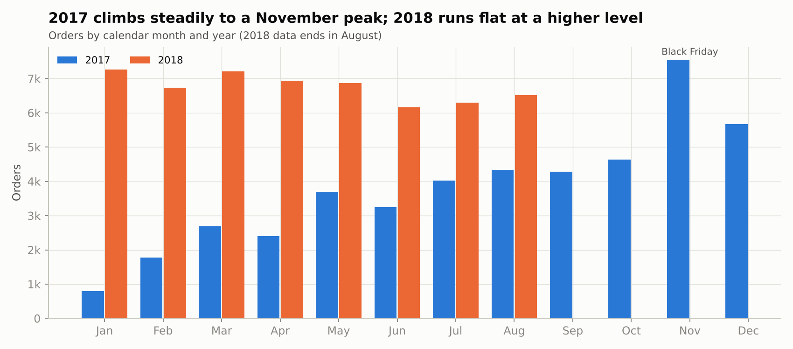 | 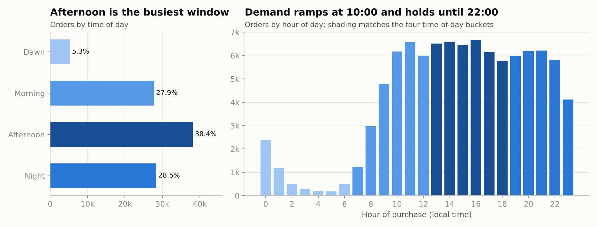 | 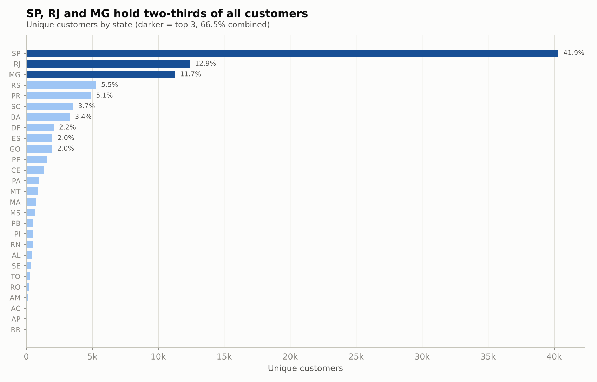 |
| 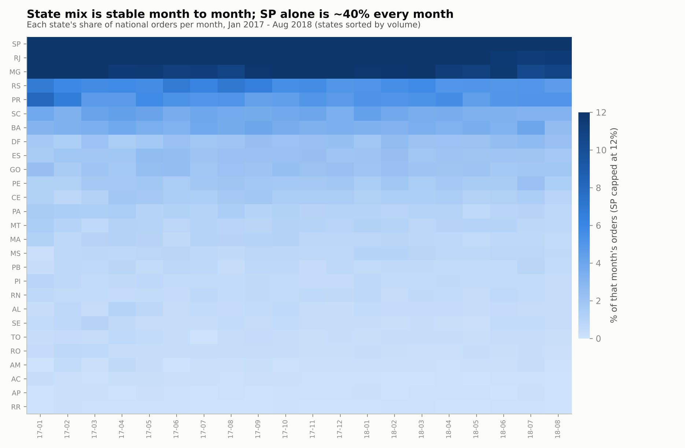 | 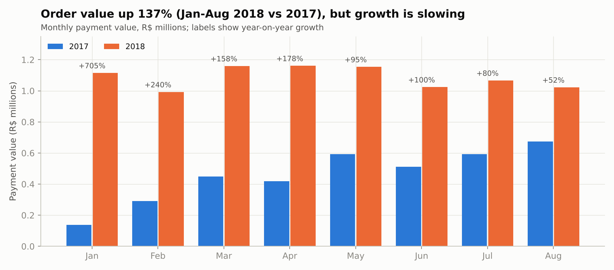 | 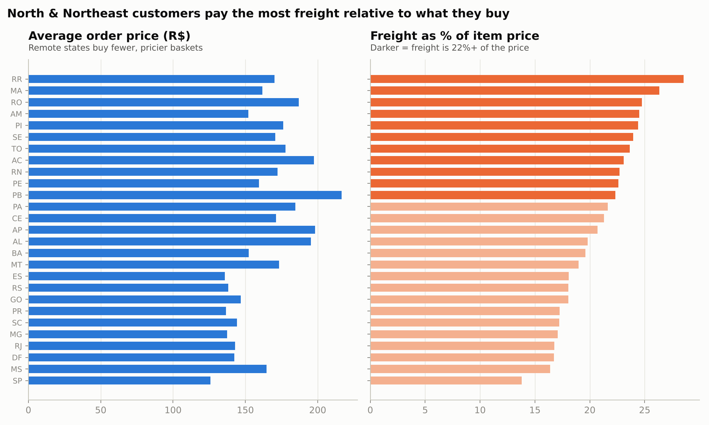 |
| 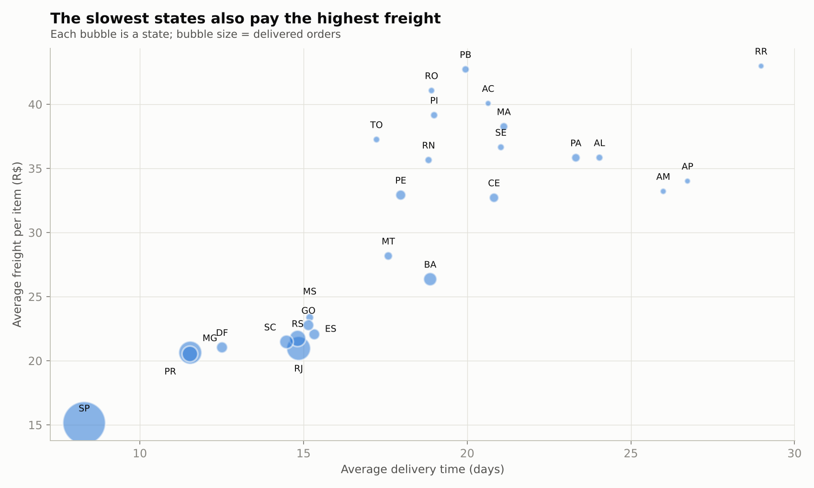 | 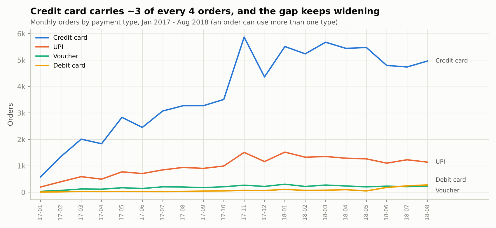 | 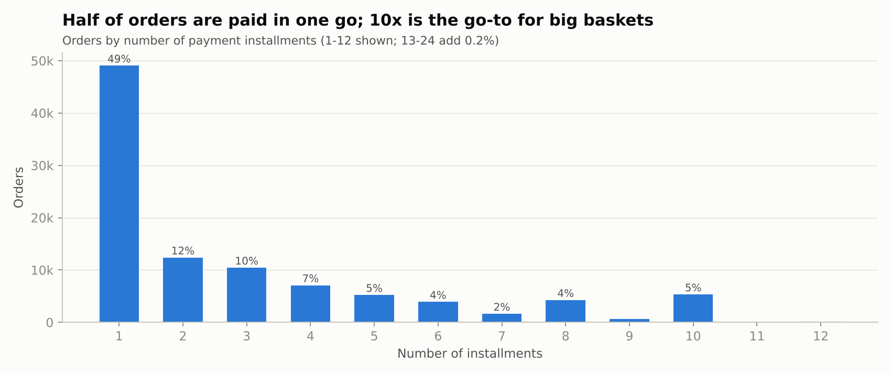 |

## Repository structure

```
.
├── data/                  8 raw CSVs, schema image, data dictionary
├── sql/
│   ├── bigquery/          one .sql file per question + 00_all_queries.sql (BigQuery dialect)
│   └── duckdb/            the same queries translated for DuckDB
├── notebooks/             executed Jupyter notebook (+ HTML export)
├── report/                submission document: Word (.docx) and PDF (30 queries, < 50 pages)
├── charts/                15 charts (PNG)
├── outputs/
│   ├── results/           full result of every query (CSV)
│   └── screenshots/       first 10 rows of every result (PNG)
├── scripts/               pipeline: load data → export SQL → run → chart → screenshots → report → notebook
├── docs/                  problem statement
└── run_all.py             rebuilds everything from the raw CSVs
```

## Reproduce

```bash
git clone https://github.com/dot-hpg/Projects.git
cd Projects/target-brazil-sql-case-study
pip install -r requirements.txt
python run_all.py                    # ~1 minute: builds target_brazil.duckdb and every output
```

To run on **BigQuery** instead: upload the CSVs in `data/` as tables in a dataset named `target`, then run the
files in `sql/bigquery/`.

## Method notes

- **One source of truth.** Queries live once in [`scripts/query_catalog.py`](scripts/query_catalog.py) in
  BigQuery SQL; a small translator rewrites the dialect-specific functions (`TIMESTAMP_DIFF`,
  `FORMAT_TIMESTAMP`, `INFORMATION_SCHEMA`) for DuckDB, and every BigQuery query is parsed with `sqlglot` as a
  syntax check.
- **Delivery maths** follows the brief: `time_to_deliver = delivered - purchased`,
  `diff_estimated_delivery = delivered - estimated`, in whole days. An order is *late* when
  `diff_estimated_delivery > 0`.
- **Customers** are counted with `customer_unique_id` (a person), not `customer_id` (one per order).
- **Data cleaning** (encoding of the reviews file, renamed category column, duplicate geolocation rows) is
  documented in [`data/README.md`](data/README.md).

## Author

**Guntuku Hariprasad** · GitHub [@dot-hpg](https://github.com/dot-hpg)

Code is MIT-licensed. The datasets were provided for the Scaler *Target SQL* business case and are included for
reproducibility and educational use.
