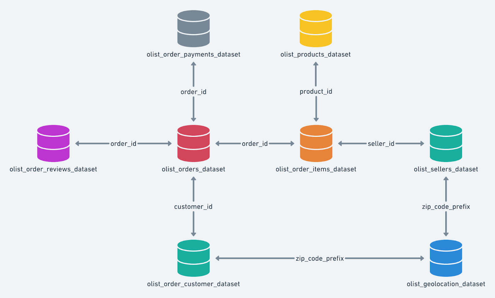

# Data

The eight raw CSV files of the Target Brazil case study, exactly as provided (unmodified). `scripts/build_db.py` loads them into DuckDB under schema `target`, mirroring the BigQuery dataset `target`.

| Table | File | Rows | Size |
|---|---|---:|---:|
| `customers` | [`customers.csv`](customers.csv) | 99,441 | 9.0 MB |
| `sellers` | [`sellers.csv`](sellers.csv) | 3,095 | 0.2 MB |
| `orders` | [`orders.csv`](orders.csv) | 99,441 | 17.7 MB |
| `order_items` | [`order_items.csv`](order_items.csv) | 112,650 | 15.4 MB |
| `payments` | [`payments.csv`](payments.csv) | 103,886 | 5.7 MB |
| `order_reviews` | [`order_reviews.csv`](order_reviews.csv) | 99,224 | 9.9 MB |
| `products` | [`products.csv`](products.csv) | 32,951 | 2.3 MB |
| `geolocation` | [`geolocation.csv`](geolocation.csv) | 1,000,163 | 61.3 MB |

`geolocation.csv` (61 MB) is committed as a regular file; it is under GitHub's 100 MB file limit.

## Data quality notes

- `order_reviews.csv` is not valid UTF-8 (some titles contain truncated byte sequences); it is read as latin-1. Review dates are in `dd/mm/yy H:MM` format.
- `products.csv` names the category column `product category`; it is renamed to `product_category_name`. 610 products have no category.
- `customer_id` is one per order; use `customer_unique_id` to count people (96,096).
- `geolocation` has many rows per zip prefix (1,000,163 rows, 19,015 prefixes): aggregate before joining.
- 8 delivered orders have no delivery date; 775 orders have no items; 1 order has no payment.

## Columns

### `customers`

| Column | Type (DuckDB) | Description |
|---|---|---|
| `customer_id` | VARCHAR | ID of the customer for one order (one per order) |
| `customer_unique_id` | VARCHAR | Unique ID of the person |
| `customer_zip_code_prefix` | BIGINT | First 5 digits of the customer's zip code |
| `customer_city` | VARCHAR | Customer city |
| `customer_state` | VARCHAR | Customer state code (e.g. SP) |

### `sellers`

| Column | Type (DuckDB) | Description |
|---|---|---|
| `seller_id` | VARCHAR | Unique seller ID |
| `seller_zip_code_prefix` | BIGINT | First 5 digits of the seller's zip code |
| `seller_city` | VARCHAR | Seller city |
| `seller_state` | VARCHAR | Seller state code |

### `orders`

| Column | Type (DuckDB) | Description |
|---|---|---|
| `order_id` | VARCHAR | Unique order ID |
| `customer_id` | VARCHAR | ID of the customer for one order (one per order) |
| `order_status` | VARCHAR | delivered, shipped, canceled, ... |
| `order_purchase_timestamp` | TIMESTAMP | When the order was placed |
| `order_approved_at` | TIMESTAMP | When payment was approved |
| `order_delivered_carrier_date` | TIMESTAMP | When the order was handed to the carrier |
| `order_delivered_customer_date` | TIMESTAMP | When the customer received the order |
| `order_estimated_delivery_date` | TIMESTAMP | Delivery date promised at purchase |

### `order_items`

| Column | Type (DuckDB) | Description |
|---|---|---|
| `order_id` | VARCHAR | Unique order ID |
| `order_item_id` | BIGINT | Item sequence number within the order |
| `product_id` | VARCHAR | Product ID |
| `seller_id` | VARCHAR | Unique seller ID |
| `shipping_limit_date` | TIMESTAMP | Date by which the seller must ship |
| `price` | DOUBLE | Item price (R$) |
| `freight_value` | DOUBLE | Freight charged for the item (R$) |

### `payments`

| Column | Type (DuckDB) | Description |
|---|---|---|
| `order_id` | VARCHAR | Unique order ID |
| `payment_sequential` | BIGINT | Sequence when an order uses several payments |
| `payment_type` | VARCHAR | credit_card, UPI, voucher, debit_card |
| `payment_installments` | BIGINT | Number of installments |
| `payment_value` | DOUBLE | Amount paid (R$) |

### `order_reviews`

| Column | Type (DuckDB) | Description |
|---|---|---|
| `review_id` | VARCHAR | Review ID |
| `order_id` | VARCHAR | Unique order ID |
| `review_score` | BIGINT | 1-5 rating |
| `review_comment_title` | VARCHAR | Review title (mostly empty) |
| `review_creation_date` | TIMESTAMP | When the review was sent |
| `review_answer_timestamp` | TIMESTAMP | When the review was answered |

### `products`

| Column | Type (DuckDB) | Description |
|---|---|---|
| `product_id` | VARCHAR | Product ID |
| `product_category_name` | VARCHAR | Category (source header: `product category`) |
| `product_name_length` | BIGINT | Characters in the product name |
| `product_description_length` | BIGINT | Characters in the description |
| `product_photos_qty` | BIGINT | Number of photos |
| `product_weight_g` | BIGINT | Weight (g) |
| `product_length_cm` | BIGINT | Length (cm) |
| `product_height_cm` | BIGINT | Height (cm) |
| `product_width_cm` | BIGINT | Width (cm) |

### `geolocation`

| Column | Type (DuckDB) | Description |
|---|---|---|
| `geolocation_zip_code_prefix` | BIGINT | First 5 digits of a zip code |
| `geolocation_lat` | DOUBLE | Latitude |
| `geolocation_lng` | DOUBLE | Longitude |
| `geolocation_city` | VARCHAR | City |
| `geolocation_state` | VARCHAR | State |
